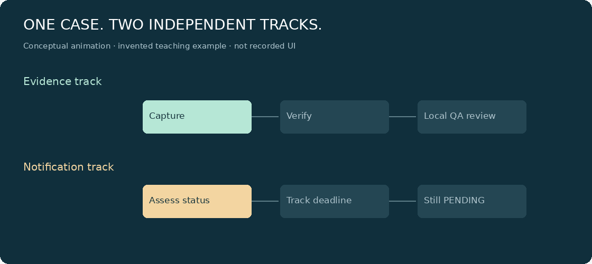
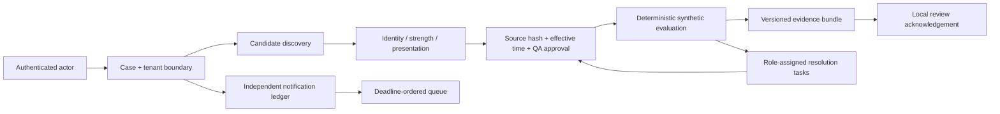

# Coldchain Evidence Workbench

**A temperature alarm is a question. This workbench shows the working.**

A small, runnable, evidence-first review desk: capture a case, inspect candidate sources,
resolve missing authority, preserve a replayable bundle, and keep notification deadlines
independent of review.

> **SYNTHETIC demonstration — not a medical device, release engine or regulatory system.**
> Every fixture, policy, approval and identifier is invented. Local QA acknowledgements
> are not qualified professional signatures. Production-oriented engineering is not production qualification.



*Original conceptual animation, not a recording of the application. Static [PNG](docs/assets/two-tracks.png).*

## Run it in three steps

Requires Python **3.12–3.14** and [uv](https://docs.astral.sh/uv/getting-started/installation/).
No Docker, Node build, database server, account or paid API is needed.

```bash
# 1. Inside this repository
uv sync --locked

# 2. Start the synthetic demo (loopback only)
uv run --locked python -m workbench demo

# 3. In a SECOND terminal, get the local QA key
uv run --locked python -m workbench credential harbor-qa
```

Open **http://127.0.0.1:8174** and paste that key into “Local role key”.
Keys are generated locally, expire after 24 hours, and remain only in browser memory.
The server stores hashes, not raw keys. `.runtime/credentials.json` is owner-readable and ignored by Git.
Never paste keys into issues, screenshots or URLs.

**Without uv:** `python3 -m venv .venv`, activate the venv, then
`python -m pip install --require-hashes -r requirements.txt` and `python -m workbench demo`.
The exported requirements contain pinned runtime dependencies and hashes. `uv.lock` also pins development tools.

### What should I try?

| Case | What you should see | What it does **not** mean |
|---|---|---|
| `DEMO-READY` | Synthetic source chain, explicit checks, local QA acknowledgement, reproducible replay | Medicine is safe to release |
| `DEMO-QUESTIONS` | Four role-assigned tasks: study applicability, SOP overlap, exposure relationship, batch history | Pick the friendliest source or block without explanation |
| `DEMO-OUTSIDE` | Captured arithmetic outside an invented envelope | Destroy or quarantine a real product |

1. Select **DEMO-READY** → **Assemble evidence** → inspect checks and sources.
2. Enter a reviewer label → **Record local acknowledgement**. The pending notification stays visible.
3. Click **Replay captured inputs**. It reproduces the calculation, not evidence truth.
4. Select **DEMO-QUESTIONS**. Each task says the required role, evidence requested,
   completion criterion and synthetic source citation. Candidate rejections are inspectable.
5. Lock the workspace. Log in with `meadow-reader` to see a different tenant with no case access.

For source attachment → approval → task completion, see the executable examples in
[the demo guide](docs/demo.md). Attachments begin **unapproved**. Blank transcriptions and cleared flags cannot complete a task.

## Why this slice?

Think of a parcel with a report card. A thermometer beep does not tell you whether the contents
are spoiled. First prove which contents, which manual, which rulebook and which observations
apply. Then a qualified person decides. Meanwhile, a reporting deadline may already be running.

The hard part is not a comparison like `12 < 19`. It is ensuring the comparison is **permitted**,
scoped to the tenant, grounded in attached source bytes, and preserved with its uncertainty.
This repository makes that boundary executable instead of building a broad pretend platform.



## Inspect the engineering

| Responsibility | Location | Boundary |
|---|---|---|
| Pure policy evaluation | [`workbench/domain.py`](workbench/domain.py) | No database, network, current clock, LLM or later outcomes |
| Durable state and authorization | [`workbench/store.py`](workbench/store.py) | Scoped SQL, explicit transactions, append-only records |
| Typed HTTP adapter | [`workbench/api.py`](workbench/api.py) | Bearer authentication, strict inputs, role checks, body limit |
| Understandable frontend | [`workbench/static/`](workbench/static/) | Plain HTML/CSS/JS; authorization remains server-side |
| Synthetic data / backup | [`workbench/demo.py`](workbench/demo.py) | Invented fixtures only; no remote ingestion |
| Safety regressions | [`tests/`](tests/) | Negative inputs, source tamper, races, tenant denial, independent clocks |

**The stack:** FastAPI + Pydantic + Python's SQLite + Uvicorn. No agent framework,
vector database, LLM or distributed orchestrator. [Research and trade-offs](docs/research.md)
explain why, including Django and PostgreSQL alternatives. Popularity is not a correctness argument.

### Verify it yourself

```bash
uv run --locked python -m pytest --cov=workbench --cov-report=term-missing
uv run --locked ruff check .
uv run --locked ruff format --check .
uv run --locked python -m scripts.smoke
uv run --locked python -m pip_audit -r requirements.txt --require-hashes --disable-pip
```

The smoke command starts a real loopback HTTP server, exercises auth/evaluation/acknowledgement,
terminates it, starts a new process, and verifies persisted obligations and replay. No generated keys are printed.
See [observed verification results](docs/acceptance.md); configured CI is **not** the same as observed CI.

## Status, without marketing

**Implemented and locally tested:** durable independent obligation queue; UNKNOWN reportability;
scoped roles; attached-source approval gates; explicit bound strictness; finite/ordered measurements;
explainable candidate rejection and resolution tasks; immutable linked snapshots; source/bundle hash checks;
expected-hash review acknowledgement; idempotency and racing-reviewer rejection; replay; backup/restore.

**Designed / deferred:** live upstream connectors, automatic non-actionable alert closure, real clinical
policy qualification, full raw-series and batch ledger, regulator submissions, verified e-signatures,
MFA/dual-signature workflows, regional storage, PostgreSQL/RLS, WORM retention and distributed workers.
Nothing in the demo proves a production closure rate, regulatory compliance or scalable capacity.

### Reviewer reading order

1. [Position paper](docs/position-paper.md) · [3-page printable PDF](docs/position-paper.pdf)
2. [HLD](docs/hld.md) — boundaries, failures, scale path, team decomposition
3. [LLD](docs/lld.md) — data, interfaces, ordering, state and recovery
4. [Threat model](docs/threat-model.md) · [Runbook](docs/runbook.md)
5. [Verification / limitations](docs/acceptance.md) · [Honest AI working log](docs/ai-working-log.md)
6. [Interview walkthrough](docs/walkthrough.md) · [cost and rollout design](docs/cost-rollout.md)

This public tree contains no private assignment documents or customer extracts. Source-to-requirement
mapping and original-business targets are retained separately for the owner, not licensed for redistribution.
[MIT license](LICENSE) covers this original code and original illustrative assets, not dependencies or third-party documents.
