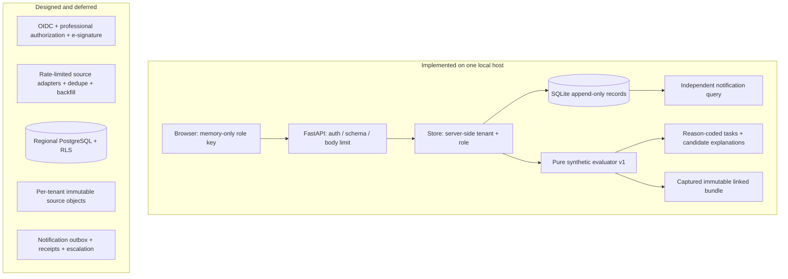

# High-level design

## Scope and status

**Built:** one local modular monolith, one host, one SQLite file, static browser UI, a pure
versioned synthetic evaluator. **Designed only:** regional managed services below.
The demo is not an ingestion platform or an autonomous pharmaceutical adjudicator.

## Responsibilities and trust boundaries

- **UI:** rendering, navigation, local clipboard-key entry. It has no authority to select tenant or
  assign its role. Tokens are neither cookies nor persisted browser data. Shared terminals must lock
  or reload; a typed label is merely descriptive.
- **HTTP adapter:** body limited to 256 KiB (including chunked), strict typed write models, generic
  validation errors without input echo, trusted local Host allowlist, restrictive CSP, no-store responses.
  Public endpoints return static assets/schema/liveness, never case records or credentials.
- **Store:** validates the credential against active/expiry membership on every operation; parameterized
  object-scoped queries; roles; one transaction for meaningful state changes. No caller-controlled tenant
  field on create/attach/acknowledge. `provision` is a trusted local administration function, not HTTP.
- **Evaluator:** no database, network, external clock or model provider; consumes only its snapshot.
  It evaluates explicit synthetic structured policies, not prose. Wrong presentation, wrong study type,
  unreadable/missing bytes, absent approval, ambiguous applicable SOPs, incomplete history, unresolved
  sensor uncertainty or extra constraints prevent a supported result.
- **Regulatory track:** created with case intake; independent query and update transactions. The raw N/Y
  flag has no qualification. A Regulatory assessment with basis may set NOT_REQUIRED or REPORTABLE.
  SENT records an asserted external receipt reference in text; it is **not verified delivery**.
- **Storage:** owner-readable local file, append-only application triggers, SHA-256 source and bundle
  expectations. No source folders or raw attachments are served by the static mount.

## Failure behavior

| Failure | Behavior now | Production extension (deferred) |
|---|---|---|
| Unauthenticated / expired / revoked token | 401 at HTTP boundary; deny service operation | OIDC short-lived sessions, revocation, step-up |
| Wrong tenant or role | 403, no object content | RLS defense in depth; isolated object keys/caches |
| Missing applicable authority | Useful tasks with evidence requests | Authority service, controlled review and delegation |
| Source/bundle mismatch | Reject; no new supported evaluation or acknowledgement | WORM object versions + signed manifests + incident alerts |
| Invalid/nonfinite/reversed measurements | Input 422 or explicit measurement task; never safety evidence | Raw-series quality/completeness gate |
| SQLite busy/disk service unavailable | 503 for operational errors; rollback transaction | Backpressure, per-tenant queues, retry budget |
| Evidence assembly raises | Existing obligations remain durable; UI loads queue independently | Separate worker pool and notification priority lane |
| Process exits after commit before response | Persisted data; retry acknowledgement with same key | Durable inbox/outbox and delivery dedupe |
| New source/approval after evaluation | Old bundle retained; acknowledgement rejects old revision | Evidence change event creates reassessment task |
| Unsupported stored evaluator version | Replay refuses rather than substitute current logic | Version registry/container retention and qualification |
| Notification sender unavailable | Not implemented: no external sending | Outbox independent of disposition, retries + human escalation |

No claim of high availability: if this host/database is unavailable, both tracks are unavailable.
Independence means no logical state coupling, not separate infrastructure or an availability guarantee.

## Scaling design, not scaling claims

Current reads also take `BEGIN IMMEDIATE`: this deliberately serializes local operations for a small,
auditable implementation. Whole-case snapshots and source text are loaded in memory. Lists are not
paginated. These are explicit local-size limits, not hidden distributed scalability.

Before multi-host use:
1. Per-region PostgreSQL; application role must not own tables or bypass RLS. Enable/force tenant row
   policies; scope transaction context from authenticated membership, reset pooled connections.
2. Per-tenant object namespaces and encryption context; source version immutable, bundle records hash
   plus object version. Never derive tenant from a filename. No cross-tenant shared embeddings or caches.
3. Partition telemetry intake separately from case evaluation. Idempotent vendor event IDs, event time vs
   observed-at time, late-arrival watermarks and explicit completeness; do not infer gaps away.
4. Durable worker inbox/outbox in transactions. Bounded per-tenant concurrency, fair queue scheduling,
   independent deadline scanning and priority escalation to keep storms from starving other tenants.
5. Explicit migration scripts, backfill/rollback plans, row-lock acknowledgement equivalence and failure
   tests against PostgreSQL. Database replacement is not an adapter-only change.
6. Observe queue latency, fairness, lock waits, bundle byte volume and restore time under representative
   peak distributions. Qualify retention and inspector retrieval from cold storage.

## Build-team split and integration gates

| Owner role (not a person) | Contract / deliverable | Qualification gate |
|---|---|---|
| Source intake + identity engineer | Provenanced entity IDs, measured series, effective/observed times | Wrong-strength/presentation and delayed/out-of-order tests |
| Controlled authority engineer | Source bytes, approvals, effective sites, resolved annexure graph | QA-approved conflicting-source test corpus |
| Workbench/evaluator engineer | Immutable snapshots, task reasons, version registry | Strict-bound/replay/unknown-history regressions |
| Notification engineer | Qualified programme config, explicit deadline, outbox/receipts | Calendar, duplicate delivery, missed-deadline drills |
| Platform/security engineer | Residency, OIDC, RLS, keys, immutable retention, restore | Tenant isolation, recovery, threat review |
| Independent QA/evaluation engineer | Historical corpus adjudication and change-impact reports | Explained differences, denominators, sign-off before changes |

Names and clinical authority must come from approved onboarding, never fixture invention.
